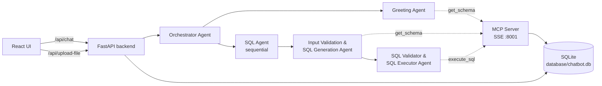

# Multi-Agent SQL Chatbot

Chat with your spreadsheets. Upload Excel or CSV files, ask questions in plain English, and a team of AI agents turns them into safe, read-only SQL, runs it, and explains the results.

Built with **Google ADK** for agent orchestration, **LiteLLM** for model access, **FastMCP** for tools, **FastAPI** for the backend, and **React + Vite** for the UI.

---

## Why

Answering a question about tabular data usually means knowing SQL and knowing the schema. This project removes both: the agents read the schema for you, write the query, check it, and return a readable answer, so anyone can explore their data.

## Features

- **Natural-language queries**: ask "What's the average salary by department?" instead of writing SQL.
- **Multiple files**: upload up to 10 `.csv`, `.xlsx`, or `.xls` files and query across them. Each Excel sheet becomes its own table.
- **Read-only by design**: only `SELECT` queries are generated and executed. Inserts, updates, and deletes are rejected.
- **Schema-aware**: queries are generated from, and validated against, the real schema of your uploaded data.
- **Starter and follow-up questions**: the chatbot suggests questions to get started and to dig deeper after each answer.
- **Schema panel**: inspect the generated schema for every uploaded file in the UI.
- **Duplicate detection**: files are hashed on upload, so the same file isn't loaded twice.
- **Model-agnostic**: any LiteLLM-supported model works (Gemini, OpenAI, and others), selected with one environment variable.

---

## How it works



### Agents

| Agent | Type | Role |
|---|---|---|
| **Orchestrator** | `LlmAgent` | Entry point. Reads the user's intent and hands off to the Greeting Agent or the SQL Agent. |
| **Greeting** | `Agent` | Welcomes the user, explains what the chatbot can do, and suggests starter questions based on the current schema. |
| **SQL** | `SequentialAgent` | Runs the two-step SQL pipeline below, in order. |
| **Input Validation & SQL Generation** | `LlmAgent` | Checks the request is read-only and refers to real tables and columns, then writes the SQL. Output is stored in session state as `generated_sql`. |
| **SQL Validator & SQL Executor** | `LlmAgent` | Re-checks the SQL against the schema, executes it, formats the answer, and adds follow-up suggestions. Output is stored as `query_result`. |

Agent code lives in [src/app/agents/](src/app/agents/); each agent has an `agent.py` and a `prompt.py`.

### MCP server

Database tools are exposed through a standalone **Model Context Protocol** server ([src/app/mcp_server/](src/app/mcp_server/)) instead of being wired directly into the agents. Agents connect to it as MCP clients over SSE.

| Tool | Description |
|---|---|
| `get_schema` | Returns the schema of every table currently in the database. |
| `execute_sql` | Runs a read-only SQL query and returns the results. |

Keeping tools behind MCP means they can be reused by other agents or clients, and the server can be run or scaled on its own.

### File upload flow

1. **Upload**: the UI sends files to `POST /api/upload-file`. Only `.csv`, `.xlsx`, and `.xls` are accepted.
2. **Store**: each file is saved under `uploads/` with a UUID name. Metadata (original name, upload time, SHA-256 hash) goes to `metadata/`.
3. **Schema**: column names and types are inferred with Pandas and saved as JSON in `schemas/`.
4. **Load**: rows are written to a persistent SQLite database at `database/chatbot.db`.
5. **Query**: agents read the schema via `get_schema` and run queries via `execute_sql`.

On startup, the backend reloads any files already in `uploads/`.

All four folders (`uploads/`, `schemas/`, `metadata/`, `database/`) are created in the project root by default, no matter which directory you start the servers from. Set `DATA_DIR` to store them elsewhere (see [Configure the backend](#2-configure-the-backend)).

---

## Getting started

### Prerequisites

- Python 3.13+ and [uv](https://docs.astral.sh/uv/)
- Node.js 20+ and npm
- An API key for a LiteLLM-supported model provider (e.g. Google Gemini or OpenAI)

### 1. Clone

```bash
git clone <repository-url>
cd multiagent-SQLchatbot
```

### 2. Configure the backend

Create `src/app/.env`:

```env
# Any LiteLLM model string, e.g. gemini/gemini-2.5-flash or openai/gpt-4o-mini
MODEL=gemini/gemini-2.5-flash

# Set the key for your provider
GOOGLE_API_KEY=your_google_api_key
# OPENAI_API_KEY=your_openai_api_key

# Optional: where uploads/, schemas/, metadata/ and database/ are stored.
# Defaults to the project root. Relative paths are resolved against the project root.
# DATA_DIR=data
```

Install dependencies:

```bash
cd src/app
uv sync
```

### 3. Start the MCP server

The agents need this running before the backend handles any chat request.

```bash
cd src/app
uv run python mcp_server/server/mcp_server.py
```

Runs at `http://127.0.0.1:8001` (SSE endpoint `/sse`).

### 4. Start the backend

In a new terminal:

```bash
cd src/app
uv run python main.py
```

Runs at `http://localhost:8000`. Interactive API docs are at `http://localhost:8000/docs`.

> The MCP server and the backend share the same data folders, resolved from the project root (or `DATA_DIR`), so they always read the same database.

### 5. Start the frontend

Create `ui/.env`:

```env
VITE_API_URL=http://localhost:8000
```

Then:

```bash
cd ui
npm install
npm run dev
```

Open `http://localhost:5173`.

---

## Usage

1. **Upload** one or more Excel/CSV files from the sidebar.
2. **Ask** a question in plain English, for example:
   ```
   How many rows are in each table?
   Show the top 10 highest-paid employees
   What is the average order value by region?
   List customers who placed more than 5 orders
   ```
3. **Read** the answer, view the schema panel if you want to check column names, and click a suggested follow-up to keep exploring.

Say "hi" or ask what the bot can do to get starter questions for your data.

### API

| Method | Endpoint | Description |
|---|---|---|
| `POST` | `/api/chat` | Send a message to the agents |
| `DELETE` | `/api/session/{session_id}` | Clear a chat session |
| `POST` | `/api/upload-file` | Upload a file (one per request) |
| `GET` | `/api/file-status` | List uploaded files and their schemas |
| `DELETE` | `/api/file/{file_id}` | Delete one file |
| `DELETE` | `/api/files/all` | Delete all files |
| `GET` | `/api/health` | Health check |

---

## Tech stack

**Backend:** Python, FastAPI, Uvicorn, Google ADK, LiteLLM, FastMCP / MCP, Pandas, SQLite, openpyxl, xlrd

**Frontend:** React 19, TypeScript, Vite, Axios

**Tooling:** uv, oxlint

---

## Project structure

```
multiagent-SQLchatbot/
├── src/app/
│   ├── agents/
│   │   ├── orchestrator_agent/
│   │   ├── greeting_agent/
│   │   ├── sql_agent/
│   │   ├── inputValidationAndSqlGeneration_agent/
│   │   └── sqlValidatorAndSqlExecutor_agent/
│   ├── mcp_server/
│   │   ├── server/          # MCP server (mcp_server.py) and client toolset (mcp_toolset.py)
│   │   └── tools/           # get_schema, execute_sql implementations
│   ├── routes/              # chat, file_manager, health
│   ├── services/            # ADK runner and session services
│   ├── models/              # Request/response models
│   ├── utils/               # Database, schema generation, response parsing
│   ├── config/              # API key configuration
│   ├── main.py              # FastAPI entry point
│   └── pyproject.toml
└── ui/
    └── src/
        ├── components/      # ChatView, Composer, MessageBubble, SchemaPanel, Sidebar, UploadModal
        ├── services/        # API calls
        ├── context/         # App state
        └── utils/           # Response parsing, markdown tables
```
